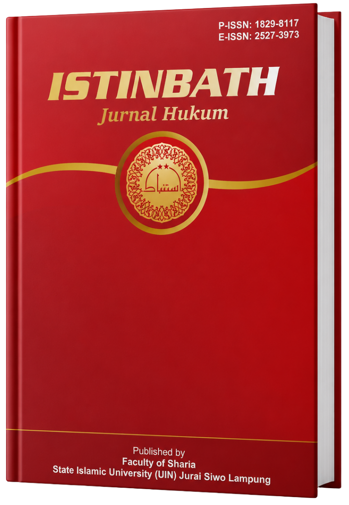

After nearly five months of waiting, **Istinbath: Jurnal Hukum** has officially appeared in the **Scopus database**. This milestone marks an important stage in the journal’s long academic journey and represents a significant achievement for the editorial team, reviewers, authors, Faculty of Sharia, and UIN Jurai Siwo Lampung.

Istinbath: Jurnal Hukum had previously received acceptance from the **Scopus Content Selection and Advisory Board (CSAB)** on **12 July 2026**. Following the acceptance, the journal entered the Scopus onboarding and content-processing stages. The waiting period involved a series of administrative and technical processes before the journal could finally be displayed and discoverable in the Scopus database.

<figure style="margin: 1.6rem 0 1.8rem 0; text-align: center;">
  
  <figcaption style="margin-top: 0.7rem; font-size: 0.82rem; opacity: 0.68; text-align: center;">
    Istinbath: Jurnal Hukum, Faculty of Sharia, UIN Jurai Siwo Lampung.
  </figcaption>
</figure>

The official appearance of Istinbath in Scopus is more than an indexing achievement. It reflects years of collective efforts to strengthen editorial governance, improve publication quality, maintain academic integrity, expand the journal’s international visibility, and ensure consistency in the publication of scholarly works in the field of Islamic law and related legal studies.

For the editorial team, the process has required continuous improvement in manuscript selection, peer-review procedures, publication ethics, metadata management, website quality, international authorship, and the scholarly relevance of published articles. Each of these elements has played an important role in positioning Istinbath as a journal capable of participating in a broader international academic conversation.

The inclusion of Istinbath in Scopus also creates new opportunities for authors. Articles published in the journal will gain greater visibility within the global scholarly community, making them more accessible to researchers, institutions, and academic networks across countries. This development is expected to strengthen citation impact, research collaboration, and the international dissemination of studies in Islamic law.

At the institutional level, this achievement contributes to the growing academic profile of **UIN Jurai Siwo Lampung**, particularly the Faculty of Sharia. A Scopus-indexed journal provides an important platform for developing research culture, strengthening international academic engagement, and supporting the university’s commitment to improving the quality and visibility of scholarly publications.

Nevertheless, Scopus indexing should not be regarded as the final destination. It is instead the beginning of a new responsibility. Maintaining publication quality, editorial independence, academic ethics, international relevance, citation performance, and consistency will become increasingly important as Istinbath enters a wider global academic ecosystem.

The achievement therefore belongs not only to the current editorial team but also to previous editors, reviewers, authors, institutional leaders, technical staff, and all those who have contributed to the development of Istinbath over the years. The journal’s progress demonstrates that international recognition is built through sustained institutional commitment rather than through a single achievement.

For me personally, this moment is especially meaningful. The months following the CSAB acceptance were filled with anticipation as the journal proceeded through the Scopus onboarding process. Seeing **Istinbath: Jurnal Hukum** finally appear in the Scopus database brings both gratitude and a renewed sense of responsibility to continue improving the journal.

**Congratulations to Istinbath: Jurnal Hukum.**

May this achievement strengthen its commitment to becoming a credible, internationally visible, and academically influential platform for scholarship in Islamic law and contemporary legal studies.
