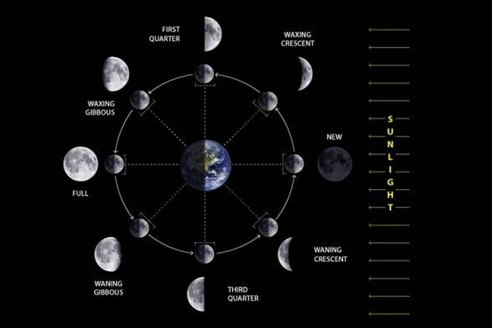

<!-- ======================================================
     HERO
====================================================== -->

  <!-- LEFT SIDE -->

  

    

      Islamic Law · Islamic Astronomy
    

    <h1 class="home-title">
      Dr. Sakirman, M.S.I.
    </h1>

    

      Lecturer · Researcher · UIN Jurai Siwo Lampung
    

    

      My academic work explores the intersection of
      <strong>Islamic law and Islamic astronomy (<em>Ilmu Falak</em>)</strong>,
      with particular attention to crescent visibility, twilight,
      sky brightness, astronomical photometry, digital imaging,
      hisab–rukyat, and scientifically informed Hijri calendar studies.
    

    

      
        Crescent Visibility
      

      
        Twilight / Syafaq
      

      
        Hisab–Rukyat
      

      
        Hijri Calendar
      

    

    

      <a class="home-button home-button-primary"
         href="/research/">
        Explore My Research →
      </a>

      <a class="home-button"
         href="/main-publications/">
        Main Publications
      </a>

      <a class="home-button"
         href="/cv/">
        Academic CV
      </a>

    

  

  <!-- RIGHT SIDE -->

  

    

      

    

    

      Lunar Phases · Crescent Visibility · Hijri Calendar
    

    

      The lunar cycle provides the astronomical framework for crescent
      observation, lunar visibility analysis, and Hijri calendar studies.
    

  

<!-- ======================================================
     SUMMARY
====================================================== -->

  

    

      Research Area
    

    

      Islamic Astronomy
    

    

      Crescent visibility, twilight, sky brightness,
      astronomical observation, photometry, and digital imaging.
    

  

  

    

      Legal Studies
    

    

      Islamic Law
    

    

      Islamic legal reasoning, maqāṣid al-sharī‘ah,
      astronomical evidence, and contemporary Islamic law.
    

  

  

    

      Academic Leadership
    

    

      Teaching, Research, and Publication
    

    

      Doctoral program leadership, academic supervision,
      curriculum development, and scholarly journal development.
    

  

<!-- ======================================================
     CURRENT RESEARCH FOCUS
====================================================== -->

  <h2 class="home-section-title">
    Current Research Focus
  </h2>

  

    

      My current research examines
      <strong>crescent visibility, twilight (<em>syafaq</em>), sky brightness,
      atmospheric conditions, hisab–rukyat, digital imaging, and astronomical photometry</strong>.
      Particular attention is given to how atmospheric conditions and lunar geometry
      influence the visibility of the young crescent Moon in tropical and
      low-latitude environments and how these findings can contribute to
      scientifically informed Hijri calendar criteria.
    

  

<!-- ======================================================
     RESEARCH INTERESTS
====================================================== -->

  <h2 class="home-section-title">
    Research Interests
  </h2>

  

    <a class="home-tag"
       href="/research-interests/#crescent-visibility">
      Crescent Visibility
    </a>

    <a class="home-tag"
       href="/research-interests/#twilight-syafaq">
      Twilight / Syafaq
    </a>

    <a class="home-tag"
       href="/research-interests/#sky-brightness">
      Sky Brightness
    </a>

    <a class="home-tag"
       href="/research-interests/#hisab-rukyat">
      Hisab–Rukyat
    </a>

    <a class="home-tag"
       href="/research-interests/#hijri-calendar">
      Hijri Calendar
    </a>

    <a class="home-tag"
       href="/research-interests/#islamic-astronomy">
      Islamic Astronomy
    </a>

    <a class="home-tag"
       href="/research-interests/#astronomical-photometry">
      Astronomical Photometry
    </a>

    <a class="home-tag"
       href="/research-interests/#digital-imaging">
      Digital Imaging
    </a>

    <a class="home-tag"
       href="/research-interests/#astronomical-evidence">
      Astronomical Evidence
    </a>

    <a class="home-tag"
       href="/research-interests/#islamic-law">
      Islamic Law
    </a>

    <a class="home-tag"
       href="/research-interests/#maqasid-al-shariah">
      Maqāṣid al-Sharī‘ah
    </a>

    <a class="home-tag"
       href="/research-interests/#islamic-family-law">
      Islamic Family Law
    </a>

  

<!-- ======================================================
     EXPLORE ACADEMIC WORK
====================================================== -->

  <h2 class="home-section-title">
    Explore Academic Work
  </h2>

  

    Explore research, publications, teaching activities, and academic
    information through the main sections of this website.
  

  

    <a class="home-link-card"
       href="/research/">

      <strong>
        Research →
      </strong>

      
        Research themes, methodology, current projects,
        research roadmap, and astronomical studies.
      

    </a>

    <a class="home-link-card"
       href="/main-publications/">

      <strong>
        Main Publications →
      </strong>

      
        Selected academic works in Islamic astronomy,
        Hijri calendar studies, and Islamic law.
      

    </a>

    <a class="home-link-card"
       href="/publications/">

      <strong>
        Full Publications →
      </strong>

      
        Complete academic publication record organized
        chronologically.
      

    </a>

    <a class="home-link-card"
       href="/teaching/">

      <strong>
        Teaching →
      </strong>

      
        Undergraduate, master's, and doctoral courses,
        learning materials, and academic teaching activities.
      

    </a>

    <a class="home-link-card"
       href="/cv/">

      <strong>
        Academic CV →
      </strong>

      
        Education, academic appointments, research expertise,
        leadership, editorial service, and professional activities.
      

    </a>

    <a class="home-link-card"
       href="https://scholar.google.com/citations?hl=en&user=eCtpuO8AAAAJ"
       target="_blank"
       rel="noopener noreferrer">

      <strong>
        Google Scholar →
      </strong>

      
        Citation profile and publication records available
        through Google Scholar.
      

    </a>

  

