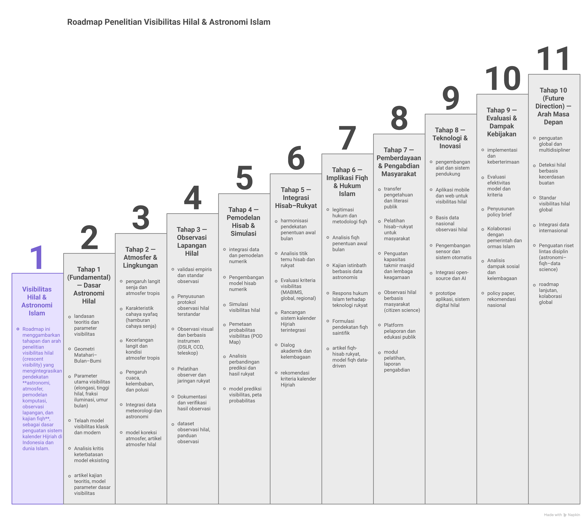

<!-- =====================================================
     HERO
===================================================== -->

<section class="research-hero">

  

    Research Program
  

  <h1 class="research-title">
    Research
  </h1>

  <h2 class="research-subtitle">
    From astronomical observation to Islamic legal reasoning
  </h2>

  

    My research explores the intersection of
    <strong>Islamic astronomy, observational science, and Islamic law</strong>.
    It focuses particularly on crescent visibility, twilight, sky brightness,
    astronomical photometry, digital image processing, Hijri calendar systems,
    and the integration of scientific evidence with Islamic legal reasoning.
  

  

    A central objective of this research program is to develop
    <strong>evidence-based approaches to astronomy for Islamic religious practices</strong>,
    linking observation, quantitative analysis, and legal interpretation in the
    study of the <em>hilal</em>, prayer times, qibla direction, and the Hijri calendar.
  

</section>

<!-- =====================================================
     RESEARCH THEMES
===================================================== -->

<section class="research-section-block">

  

    Research Themes
  

  <h2 class="research-section-title">
    Four Research Themes
  </h2>

  

    My research is organized around four interconnected themes covering
    observational astronomy, quantitative measurement, Hijri calendar studies,
    and digital image processing.
  

  

    <article class="research-card">

      <a
        href="/images/hilal-twilight.jpg"
        target="_blank"
        class="research-image-link"
      >

        
          THEME 01
        

        

      </a>

      

        <h3>
          Crescent Visibility and Twilight
        </h3>

        

          Investigation of young crescent visibility in relation to solar
          depression, twilight intensity, atmospheric conditions, lunar
          geometry, and observational constraints.
        

      

    </article>

    <article class="research-card">

      <a
        href="/images/Analisis-IRIS.png"
        target="_blank"
        class="research-image-link"
      >

        
          THEME 02
        

        

      </a>

      

        <h3>
          Astronomical Photometry and Sky Brightness
        </h3>

        

          Quantitative analysis of crescent intensity, twilight brightness,
          aperture photometry, Weber contrast, sky quality, and observational
          thresholds.
        

      

    </article>

    <article class="research-card">

      <a
        href="/images/kalender-hijriyah-2027.jpg"
        target="_blank"
        class="research-image-link"
      >

        
          THEME 03
        

        

      </a>

      

        <h3>
          Hijri Calendar and Hisab–Rukyat
        </h3>

        

          Study of lunar calendrical systems, crescent visibility criteria,
          astronomical calculation, observational evidence, institutional
          authority, and Islamic legal reasoning.
        

      

    </article>

    <article class="research-card">

      <a
        href="/images/olah-citra.jpg"
        target="_blank"
        class="research-image-link"
      >

        
          THEME 04
        

        

      </a>

      

        <h3>
          Digital Imaging and Astronomical Evidence
        </h3>

        

          Application of digital cameras, telescopes, image processing,
          calibration, enhancement, and quantitative analysis to improve
          crescent detection and astronomical documentation.
        

      

    </article>

  

</section>

<!-- =====================================================
     METHODOLOGY
===================================================== -->

<section class="research-section-block">

  

    Methodology
  

  <h2 class="research-section-title">
    From Observation to Evidence
  </h2>

  

    The research workflow integrates astronomical observation, digital imaging,
    quantitative photometry, contrast analysis, astronomical interpretation,
    and Islamic legal reasoning.
  

  

    <!-- =====================================================
         LEFT: RESEARCH LOOP
    ====================================================== -->

    

      

      

      

      

        
          Research Loop
        

        

          From Observation 
          to Evidence
        

      

      

        
          01
        

        
          Crescent Observation
        

        
          hilal · twilight · geometry
        

      

      

        
          02
        

        
          Digital Image Acquisition
        

        
          camera · telescope · RAW
        

      

      

        
          03
        

        
          Image Pre-Processing
        

        
          calibration · Siril
        

      

      

        
          04
        

        
          Aperture Photometry
        

        
          IRIS · intensity
        

      

      

        
          05
        

        
          Contrast Analysis
        

        
          Weber contrast
        

      

      

        
          06
        

        
          Astronomical Interpretation
        

        
          visibility · atmosphere
        

      

      

        
          07
        

        
          Islamic Legal Analysis
        

        
          hisab–rukyat · maqāṣid
        

      

    

    <!-- =====================================================
         RIGHT: EXPLANATION
    ====================================================== -->

    

      

        
          01
        

        

          <strong>Crescent Observation</strong> establishes the empirical
          foundation of the research through direct observation of the
          <em>hilal</em>, twilight conditions, lunar geometry, and atmospheric
          circumstances.
        

      

      

        
          02
        

        

          <strong>Digital Image Acquisition</strong> records astronomical
          observations using cameras and telescopes while preserving RAW image
          data for subsequent quantitative analysis.
        

      

      

        
          03
        

        

          <strong>Image Pre-Processing</strong> prepares observational data
          through calibration, correction, enhancement, and astronomical image
          processing using software such as Siril.
        

      

      

        
          04
        

        

          <strong>Aperture Photometry</strong> measures pixel intensity and
          astronomical brightness using IRIS to quantify the crescent signal
          and surrounding twilight background.
        

      

      

        
          05
        

        

          <strong>Contrast Analysis</strong> evaluates the visual separation
          between the crescent and sky background, including the use of Weber
          contrast as a quantitative indicator of visibility.
        

      

      

        
          06
        

        

          <strong>Astronomical Interpretation</strong> connects photometric
          measurements with atmospheric conditions, lunar geometry, twilight
          brightness, and crescent visibility criteria.
        

      

      

        
          07
        

        

          <strong>Islamic Legal Analysis</strong> interprets the astronomical
          evidence within the frameworks of <em>hisab–rukyat</em>, Islamic
          jurisprudence, and maqāṣid al-sharīʿah.
        

      

    

  

</section>

<!-- =====================================================
     SOFTWARE
===================================================== -->

<section class="research-section-block">

  

    Research Tools
  

  <h2 class="research-section-title">
    Astronomical Software
  </h2>

  

    Digital image processing and photometric analysis form an important part
    of the observational research workflow.
  

  

    <article class="software-card">

      

      

        <h3>
          Siril
        </h3>

        

          Used for astronomical image calibration, preprocessing, stacking,
          enhancement, and preparation of observational image data.
        

      

    </article>

    <article class="software-card">

      

      

        <h3>
          IRIS
        </h3>

        

          Used for aperture photometry, pixel intensity measurement, and
          quantitative comparison between crescent brightness and twilight
          background.
        

      

    </article>

  

</section>

<!-- =====================================================
     CURRENT RESEARCH
===================================================== -->

<section class="research-section-block">

  

    Current Research
  

  <h2 class="research-section-title">
    Tropical Twilight, Sky Brightness, and Crescent Visibility
  </h2>

  

    

      Current research examines the relationship between tropical twilight,
      sky brightness, atmospheric conditions, and the visibility of the young
      lunar crescent. The project combines field observation, digital imaging,
      aperture photometry, and contrast analysis to strengthen empirical
      understanding of crescent detection under tropical atmospheric
      conditions.
    

  

</section>

<!-- =====================================================
     FUTURE DIRECTIONS
===================================================== -->

<section class="research-section-block">

  

    Future Directions
  

  <h2 class="research-section-title">
    Developing Evidence-Based Islamic Astronomy
  </h2>

  

    

      <h3>
        Dark-Sky and Environmental Astronomy
      </h3>

      

        Investigation of light pollution, sky quality, atmospheric
        transparency, and their implications for Islamic astronomical
        observation.
      

    

    

      <h3>
        Digital Crescent Detection
      </h3>

      

        Development of quantitative and imaging-based approaches for
        identifying faint lunar crescents under challenging twilight
        conditions.
      

    

    

      <h3>
        Hijri Calendar Integration
      </h3>

      

        Integration of observational astronomy, visibility models, legal
        reasoning, institutional authority, and social acceptance in Hijri
        calendar studies.
      

    

    

      <h3>
        Islamic Law and Astronomical Evidence
      </h3>

      

        Development of interdisciplinary frameworks connecting empirical
        astronomical evidence with Islamic legal methodology and maqāṣid
        al-sharīʿah.
      

    

  

</section>

<!-- =====================================================
     RESEARCH TRAJECTORY
===================================================== -->

<section class="research-section-block">

  

    Research Trajectory
  

  <h2 class="research-section-title">
    Long-Term Research Trajectory
  </h2>

  

    The long-term research program develops progressively from astronomical
    observation and quantitative measurement toward interdisciplinary
    integration between astronomy, environmental studies, and Islamic law.
  

  

    

  

</section>

<!-- =====================================================
     SELECTED PROJECTS
===================================================== -->

<section class="research-section-block">

  

    Selected Projects
  

  <h2 class="research-section-title">
    Research Projects
  </h2>

  

    

      <h3>
        Crescent Visibility and Twilight Photometry
      </h3>

      

        Quantitative investigation of crescent intensity, twilight background,
        and Weber contrast using digital astronomical images.
      

    

    

      <h3>
        Timau Observatory Dark-Sky Studies
      </h3>

      

        Investigation of twilight thresholds, sky brightness, environmental
        conditions, and their relevance to astronomical observation.
      

    

    

      <h3>
        Digital Imaging for Rukyat al-Hilal
      </h3>

      

        Application of digital cameras, telescopes, image processing, and
        photometric analysis to contemporary crescent observation.
      

    

    

      <h3>
        Hijri Calendar and Islamic Legal Reasoning
      </h3>

      

        Study of astronomical criteria, hisab–rukyat, Islamic jurisprudence,
        institutional authority, and social acceptance of Hijri calendar
        systems.
      

    

  

</section>

<!-- =====================================================
     RESEARCH OUTPUTS
===================================================== -->

<section class="research-section-block">

  

    Research Outputs
  

  <h2 class="research-section-title">
    Scholarly Outputs
  </h2>

  <ul class="research-output-list">

    <li>
      Peer-reviewed journal articles in Islamic astronomy, Islamic law,
      crescent visibility, and Hijri calendar studies.
    </li>

    <li>
      Astronomical observation and photometric analysis of the hilal and
      twilight.
    </li>

    <li>
      Research on digital imaging technology for contemporary
      <em>rukyat al-hilal</em>.
    </li>

    <li>
      Interdisciplinary studies connecting astronomy, environmental science,
      Islamic jurisprudence, and maqāṣid al-sharīʿah.
    </li>

    <li>
      Academic books, conference papers, research reports, and teaching
      materials in Islamic astronomy and Islamic law.
    </li>

  </ul>

</section>

<!-- =====================================================
     FOOTER NAVIGATION
===================================================== -->

  <a
    href="/"
    class="research-footer-button"
  >
    ← Back to Home
  </a>

  <a
    href="/main-publications/"
    class="research-footer-button"
  >
    Main Publications
  </a>

  <a
    href="/cv/"
    class="research-footer-button"
  >
    Academic CV →
  </a>

<!-- =====================================================
     INTERACTIVE SCRIPT
===================================================== -->

