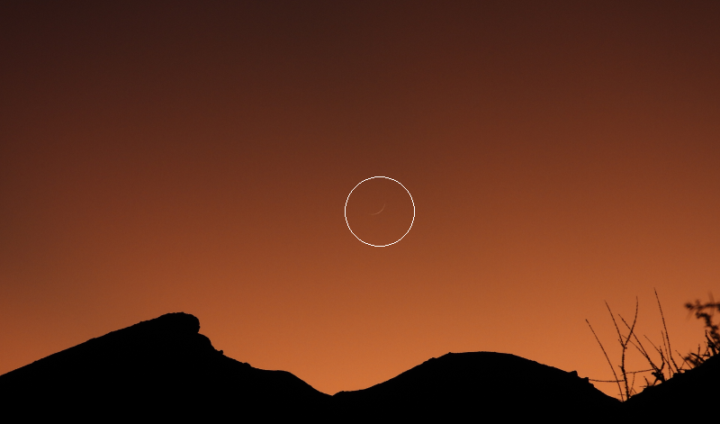
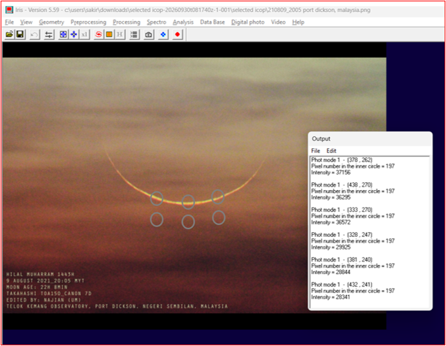
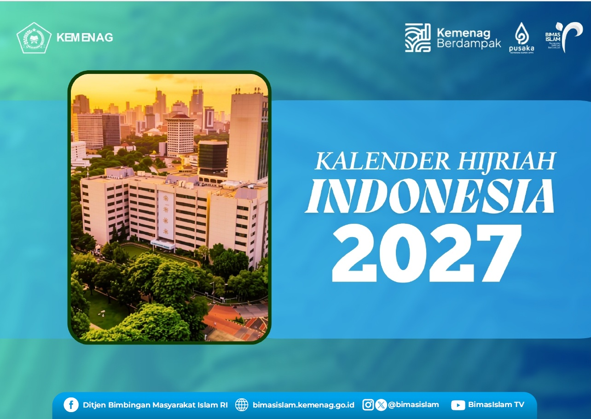
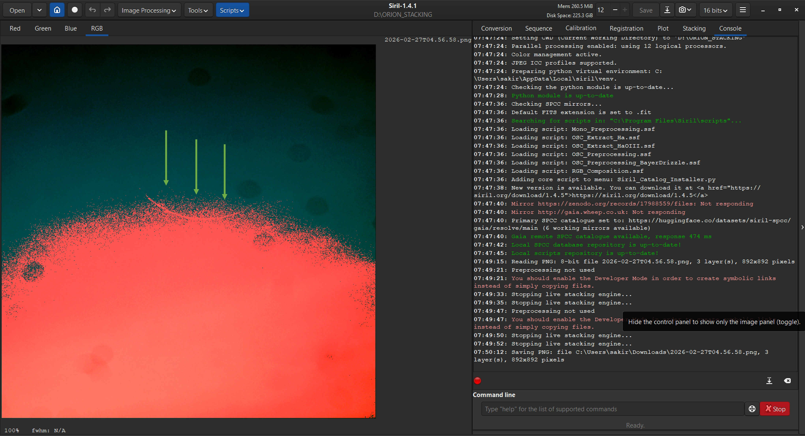

<!-- =====================================================
     HERO
===================================================== -->

<section class="research-hero">

  

    Research Program
  

  <h1 class="research-title">
    Research
  </h1>

  <h2 class="research-subtitle">
    From astronomical observation to Islamic legal reasoning
  </h2>

  

    My research explores the intersection of
    <strong>Islamic astronomy, observational science, and Islamic law</strong>.
    It focuses particularly on crescent visibility, twilight, sky brightness,
    astronomical photometry, digital image processing, Hijri calendar systems,
    and the integration of scientific evidence with Islamic legal reasoning.
  

  

    A central objective of this research program is to develop
    <strong>evidence-based approaches to astronomy for Islamic religious practices</strong>,
    linking observation, quantitative analysis, and legal interpretation in the
    study of the <em>hilal</em>, prayer times, qibla direction, and the Hijri calendar.
  

</section>

<!-- =====================================================
     RESEARCH THEMES
===================================================== -->

<section class="research-section-block">

  

    Research Themes
  

  <h2 class="research-section-title">
    Four Research Themes
  </h2>

  

    My research is organized around four interconnected themes covering
    observational astronomy, quantitative measurement, Hijri calendar studies,
    and digital image processing.
  

  

    <article class="research-card">

      <a
        href="/images/hilal-twilight.jpg"
        target="_blank"
        class="research-image-link"
      >

        
          THEME 01
        

        

      </a>

      

        <h3>
          Crescent Visibility and Twilight
        </h3>

        

          Investigation of young crescent visibility in relation to solar
          depression, twilight intensity, atmospheric conditions, lunar
          geometry, and observational constraints.
        

      

    </article>

    <article class="research-card">

      <a
        href="/images/Analisis-IRIS.png"
        target="_blank"
        class="research-image-link"
      >

        
          THEME 02
        

        

      </a>

      

        <h3>
          Astronomical Photometry and Sky Brightness
        </h3>

        

          Quantitative analysis of crescent intensity, twilight brightness,
          aperture photometry, Weber contrast, sky quality, and observational thresholds.
        

      

    </article>

    <article class="research-card">

      <a
        href="/images/kalender-hijriyah-2027.jpg"
        target="_blank"
        class="research-image-link"
      >

        
          THEME 03
        

        

      </a>

      

        <h3>
          Hijri Calendar and Hisab–Rukyat
        </h3>

        

          Study of lunar calendrical systems, crescent visibility criteria,
          astronomical calculation, observational evidence, institutional
          authority, and Islamic legal reasoning.
        

      

    </article>

    <article class="research-card">

      <a
        href="/images/olah-citra.jpg"
        target="_blank"
        class="research-image-link"
      >

        
          THEME 04
        

        

      </a>

      

        <h3>
          Digital Imaging and Astronomical Evidence
        </h3>

        

          Application of digital cameras, telescopes, image processing,
          calibration, enhancement, and quantitative analysis to improve
          crescent detection and astronomical documentation.
        

      

    </article>

  

</section>

<!-- =====================================================
     METHODOLOGY
===================================================== -->

<section class="research-section-block">

  

    Methodology
  

  <h2 class="research-section-title">
    From Observation to Evidence
  </h2>

  

    The research workflow integrates astronomical observation,
    digital imaging, image processing, quantitative measurement,
    astronomical interpretation, and Islamic legal reasoning.
  

  

    

      

      

      

        

      

      

        
          Research Loop
        

        

          From Observation 
          to Evidence
        

      

      

        
          01
        

        
          Crescent Observation
        

        
          hilal · twilight · geometry
        

        

          Establishes the empirical basis through direct observation
          of the <em>hilal</em>, twilight conditions, lunar geometry,
          and atmospheric circumstances.
        

      

      

        
          02
        

        
          Digital Image Acquisition
        

        
          camera · telescope · RAW
        

        

          Records astronomical observations using digital cameras
          and telescopes while preserving RAW image data for
          subsequent quantitative analysis.
        

      

      

        
          03
        

        
          Image Pre-Processing
        

        
          calibration · Siril
        

        

          Prepares observational data through calibration,
          correction, enhancement, and astronomical image
          processing using software such as Siril.
        

      

      

        
          04
        

        
          Photometry & Contrast
        

        
          IRIS · Weber contrast
        

        

          Measures crescent intensity, twilight brightness,
          and visual separation between the crescent and the
          background sky using IRIS and Weber contrast.
        

      

      

        
          05
        

        
          Astronomical Interpretation
        

        
          visibility · atmosphere
        

        

          Connects quantitative measurements with atmospheric
          conditions, lunar geometry, twilight brightness,
          and crescent visibility criteria.
        

      

      

        
          06
        

        
          Islamic Legal Analysis
        

        
          hisab–rukyat · maqāṣid
        

        

          Interprets astronomical evidence through
          <em>hisab–rukyat</em>, Islamic jurisprudence,
          and maqāṣid al-sharīʿah.
        

      

    

  

</section>

<!-- =====================================================
     SOFTWARE
===================================================== -->

<section class="research-section-block">

  

    Research Tools
  

  <h2 class="research-section-title">
    Astronomical Software
  </h2>

  

    Digital image processing and photometric analysis form an important part
    of the observational research workflow.
  

  

    <article class="software-card">

      

      

        <h3>
          Siril
        </h3>

        

          Used for astronomical image calibration,
          preprocessing, stacking, enhancement,
          and preparation of observational image data.
        

      

    </article>

    <article class="software-card">

      

      

        <h3>
          IRIS
        </h3>

        

          Used for aperture photometry, pixel intensity measurement,
          and quantitative comparison between crescent brightness
          and twilight background.
        

      

    </article>

  

</section>

<!-- =====================================================
     CURRENT RESEARCH
===================================================== -->

<section class="research-section-block">

  

    Current Research
  

  <h2 class="research-section-title">
    Tropical Twilight, Sky Brightness, and Crescent Visibility
  </h2>

  

    

      Current research examines the relationship between tropical twilight,
      sky brightness, atmospheric conditions, and the visibility of the young
      lunar crescent. The project combines field observation, digital imaging,
      aperture photometry, and contrast analysis to strengthen empirical
      understanding of crescent detection under tropical atmospheric conditions.
    

  

</section>

<!-- =====================================================
     FUTURE DIRECTIONS
===================================================== -->

<section class="research-section-block">

  

    Future Directions
  

  <h2 class="research-section-title">
    Developing Evidence-Based Islamic Astronomy
  </h2>

  

    

      <h3>
        Dark-Sky and Environmental Astronomy
      </h3>

      

        Investigation of light pollution, sky quality,
        atmospheric transparency, and their implications
        for Islamic astronomical observation.
      

    

    

      <h3>
        Digital Crescent Detection
      </h3>

      

        Development of quantitative and imaging-based approaches
        for identifying faint lunar crescents under challenging
        twilight conditions.
      

    

    

      <h3>
        Hijri Calendar Integration
      </h3>

      

        Integration of observational astronomy, visibility models,
        legal reasoning, institutional authority, and social acceptance.
      

    

    

      <h3>
        Islamic Law and Astronomical Evidence
      </h3>

      

        Development of interdisciplinary frameworks connecting
        empirical astronomical evidence with Islamic legal methodology
        and maqāṣid al-sharīʿah.
      

    

  

</section>

<!-- =====================================================
     ROADMAP
===================================================== -->

<section class="research-section-block">

  

    Research Trajectory
  

  <h2 class="research-section-title">
    Long-Term Research Trajectory
  </h2>

  

    The long-term research program develops progressively from astronomical
    observation and quantitative measurement toward interdisciplinary
    integration between astronomy, environmental studies, and Islamic law.
  

  

    

  

</section>

<!-- =====================================================
     SELECTED PROJECTS
===================================================== -->

<section class="research-section-block">

  

    Selected Projects
  

  <h2 class="research-section-title">
    Research Projects
  </h2>

  

    

      <h3>
        Crescent Visibility and Twilight Photometry
      </h3>

      

        Quantitative investigation of crescent intensity,
        twilight background, and Weber contrast using digital astronomical images.
      

    

    

      <h3>
        Timau Observatory Dark-Sky Studies
      </h3>

      

        Investigation of twilight thresholds, sky brightness,
        environmental conditions, and their relevance
        to astronomical observation.
      

    

    

      <h3>
        Digital Imaging for Rukyat al-Hilal
      </h3>

      

        Application of digital cameras, telescopes,
        image processing, and photometric analysis
        to contemporary crescent observation.
      

    

    

      <h3>
        Hijri Calendar and Islamic Legal Reasoning
      </h3>

      

        Study of astronomical criteria, hisab–rukyat,
        Islamic jurisprudence, institutional authority,
        and social acceptance of Hijri calendar systems.
      

    

  

</section>

<!-- =====================================================
     OUTPUTS
===================================================== -->

<section class="research-section-block">

  

    Research Outputs
  

  <h2 class="research-section-title">
    Scholarly Outputs
  </h2>

  <ul class="research-output-list">

    <li>
      Peer-reviewed journal articles in Islamic astronomy,
      Islamic law, crescent visibility, and Hijri calendar studies.
    </li>

    <li>
      Astronomical observation and photometric analysis
      of the hilal and twilight.
    </li>

    <li>
      Research on digital imaging technology for contemporary
      <em>rukyat al-hilal</em>.
    </li>

    <li>
      Interdisciplinary studies connecting astronomy,
      environmental science, Islamic jurisprudence,
      and maqāṣid al-sharīʿah.
    </li>

    <li>
      Academic books, conference papers, research reports,
      and teaching materials in Islamic astronomy and Islamic law.
    </li>

  </ul>

</section>

<!-- =====================================================
     FOOTER NAV
===================================================== -->

  <a
    href="/"
    class="research-footer-button"
  >
    ← Back to Home
  </a>

  <a
    href="/main-publications/"
    class="research-footer-button"
  >
    Main Publications
  </a>

  <a
    href="/cv/"
    class="research-footer-button"
  >
    Academic CV →
  </a>

<!-- =====================================================
     INTERACTIVE SCRIPT
===================================================== -->

