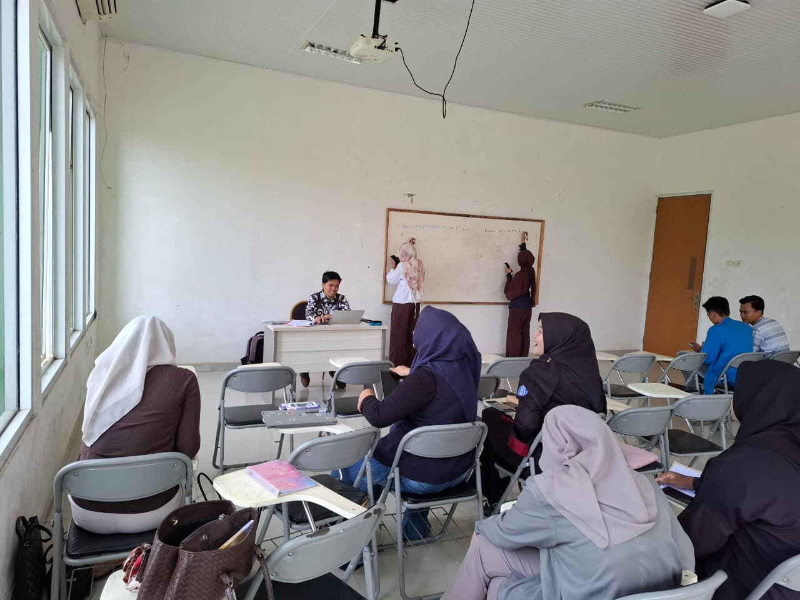
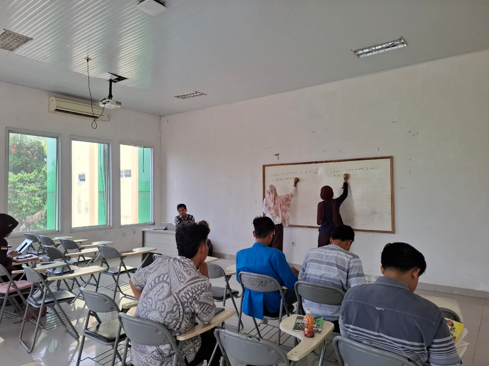
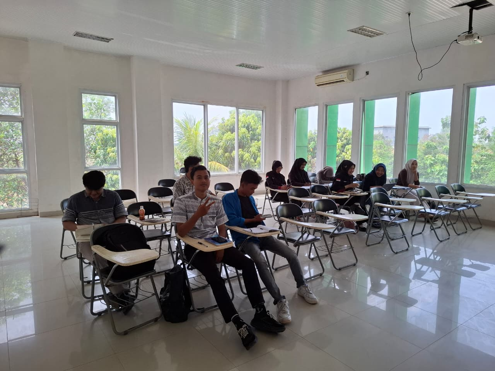
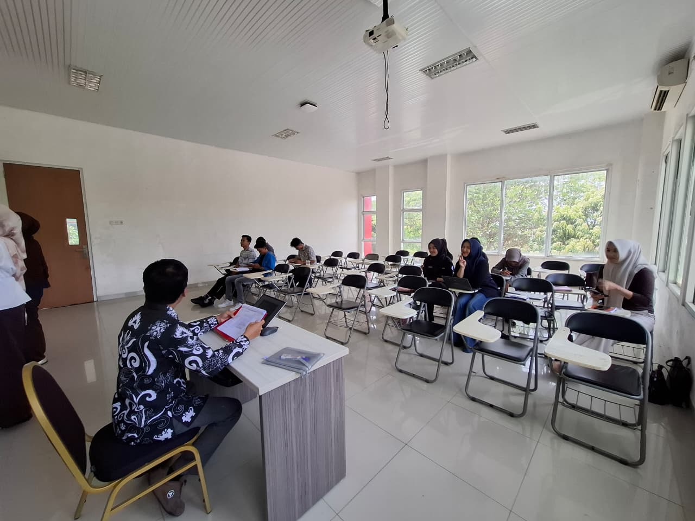
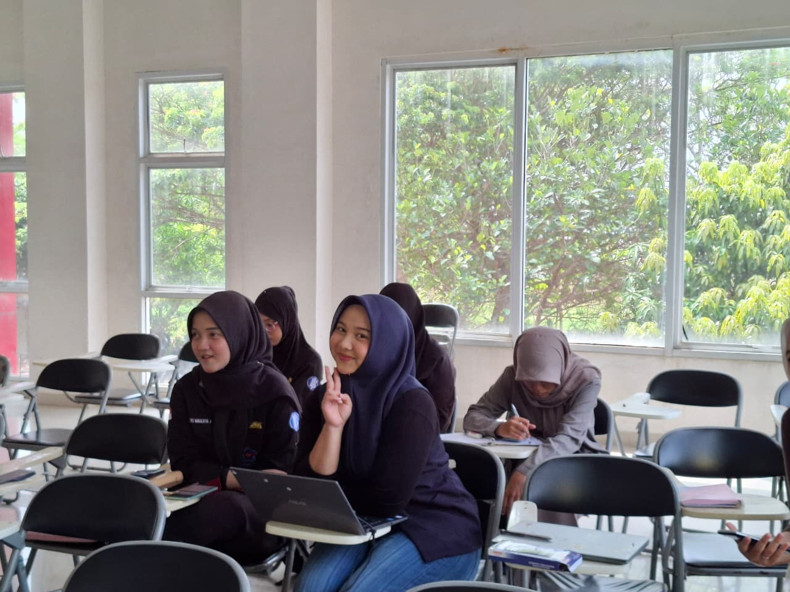
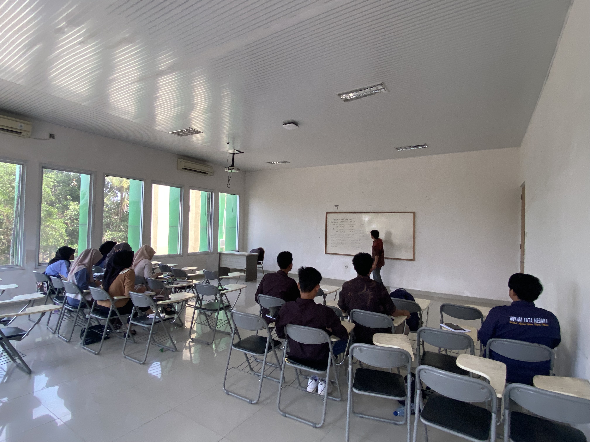
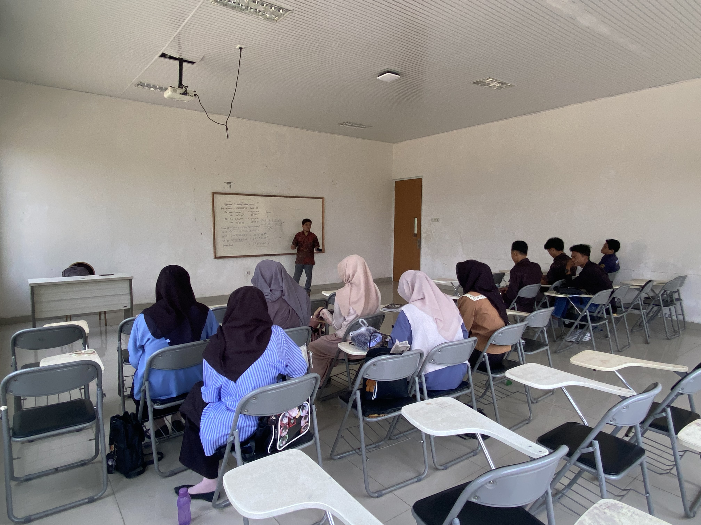
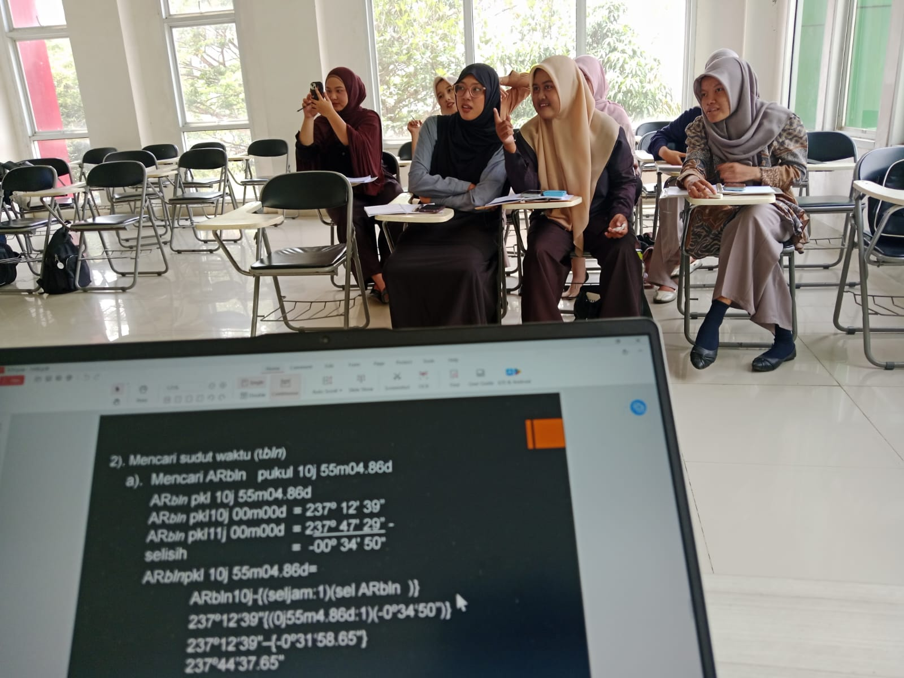

Course on **Ilmu Falak** and its application to Islamic religious practices.

The course covers Hijri calendar determination, *hisab* and *rukyat*, crescent visibility, qibla direction, prayer times, solar and lunar phenomena, astronomical coordinates, and observational methods.

The course also introduces contemporary developments in astronomical instrumentation, digital imaging, and the integration of astronomical evidence with Islamic legal reasoning.

## Course Materials

<table style="width:100%; border-collapse:collapse;">
  <thead>
    <tr>
      <th style="text-align:center; width:8%;">Meeting</th>
      <th style="text-align:left; width:52%;">Topic</th>
      <th style="text-align:center; width:20%;">Material</th>
      <th style="text-align:center; width:20%;">Download</th>
    </tr>
  </thead>

  <tbody>

    <tr>
      <td style="text-align:center;">1</td>
      <td>
        <strong>Pengantar Ilmu Falak</strong> 
        Ruang lingkup Ilmu Falak; sejarah perkembangan; kedudukan Ilmu Falak dalam studi Islam; hubungan astronomi dan fikih.
      </td>
      <td style="text-align:center;">PPT / PDF</td>
      <td style="text-align:center;"><em>Coming soon</em></td>
    </tr>

    <tr>
      <td style="text-align:center;">2</td>
      <td>
        <strong>Dasar-Dasar Astronomi untuk Ilmu Falak</strong> 
        Sistem Bumi-Bulan-Matahari; bola langit; gerak semu harian dan tahunan; horizon; ekuator; ekliptika; dan dasar-dasar astronomi yang digunakan dalam Ilmu Falak.
      </td>
      <td style="text-align:center;">PDF</td>
      <td style="text-align:center;">
        <a href="/files/teaching/ilmu-falak/01-Sistem%20Bumi-Bulan-Matahari.pdf"
           target="_blank"
           rel="noopener noreferrer">
          <strong>Download PDF</strong>
        </a>
      </td>
    </tr>

    <tr>
      <td style="text-align:center;">3</td>
      <td>
        <strong>Koordinat Geografis dan Astronomis</strong> 
        Sistem koordinat Bumi dan langit; lintang; bujur; deklinasi; asensio rekta; sudut waktu; azimut; altitude; dan penerapannya dalam perhitungan falak.
      </td>
      <td style="text-align:center;">PDF</td>
      <td style="text-align:center;">
        <a href="/files/teaching/ilmu-falak/02-Sistem%20Koordinat%20Bumi%20dan%20Langit.pdf"
           target="_blank"
           rel="noopener noreferrer">
          <strong>Download PDF</strong>
        </a>
      </td>
    </tr>

    <tr>
      <td style="text-align:center;">4</td>
      <td>
        <strong>Penentuan Arah Kiblat</strong> 
        Konsep kiblat; segitiga bola; azimut kiblat; metode trigonometri bola; rashdul qiblah; kompas; teodolit; GPS; dan aplikasi digital.
      </td>
      <td style="text-align:center;">PDF</td>
      <td style="text-align:center;">
        <a href="/files/teaching/ilmu-falak/03-Segi%20Tiga%20Bola%20dan%20Penentuan%20Arah%20Kiblat.pdf"
           target="_blank"
           rel="noopener noreferrer">
          <strong>Download PDF</strong>
        </a>
      </td>
    </tr>

    <tr>
      <td style="text-align:center;">5</td>
      <td>
        <strong>Praktik Pengukuran Arah Kiblat</strong> 
        Simulasi dan praktik penentuan arah kiblat menggunakan metode astronomis dan instrumen lapangan.
      </td>
      <td style="text-align:center;">Practicum</td>
      <td style="text-align:center;"><em>Coming soon</em></td>
    </tr>

    <tr>
      <td style="text-align:center;">6</td>
      <td>
        <strong>Waktu Salat</strong> 
        Dasar astronomis waktu Zuhur, Asar, Magrib, Isya, dan Subuh; deklinasi Matahari; equation of time; tinggi Matahari; serta perhitungan waktu salat.
      </td>
      <td style="text-align:center;">PDF</td>
      <td style="text-align:center;">
        <a href="/files/teaching/ilmu-falak/04-Astronomi%20Penentuan%20Waktu%20Shalat.pdf"
           target="_blank"
           rel="noopener noreferrer">
          <strong>Download PDF</strong>
        </a>
      </td>
    </tr>

    <tr>
      <td style="text-align:center;">7</td>
      <td>
        <strong>Praktik Perhitungan dan Verifikasi Waktu Salat</strong> 
        Perhitungan manual dan digital; koreksi geografis; observasi; serta verifikasi jadwal waktu salat.
      </td>
      <td style="text-align:center;">Practicum</td>
      <td style="text-align:center;"><em>Coming soon</em></td>
    </tr>

    <tr>
      <td style="text-align:center;">8</td>
      <td>
        <strong>Ujian Tengah Semester (UTS)</strong> 
        Evaluasi konsep dasar, arah kiblat, dan waktu salat melalui tes atau praktik terstruktur.
      </td>
      <td style="text-align:center;">Assessment</td>
      <td style="text-align:center;"><em>Coming soon</em></td>
    </tr>

    <tr>
      <td style="text-align:center;">9</td>
      <td>
        <strong>Kalender Hijriah dan Sistem Penanggalan</strong> 
        Kalender lunar; kalender solar; kalender Hijriah; konversi kalender; siklus Bulan; dan dasar penentuan awal bulan Hijriah.
      </td>
      <td style="text-align:center;">PDF</td>
      <td style="text-align:center;">
        <a href="/files/teaching/ilmu-falak/05-Dasar%20Penentuan%20Awal%20Bulan%20Hijriyah.pdf"
           target="_blank"
           rel="noopener noreferrer">
          <strong>Download PDF</strong>
        </a>
      </td>
    </tr>

    <tr>
      <td style="text-align:center;">10</td>
      <td>
        <strong>Hisab Awal Bulan Hijriah</strong> 
        Ijtimak; elongasi; tinggi hilal; umur Bulan; azimut; metode hisab hakiki; dan metode hisab kontemporer.
      </td>
      <td style="text-align:center;">PPT / PDF</td>
      <td style="text-align:center;"><em>Coming soon</em></td>
    </tr>

    <tr>
      <td style="text-align:center;">11</td>
      <td>
        <strong>Rukyat Hilal dan Kriteria Visibilitas</strong> 
        Konsep rukyat; faktor atmosfer; kontras hilal; kriteria MABIMS; keunggulan dan kelemahan kriteria kalender MABIMS; model visibilitas hilal; dan laporan observasi.
      </td>
      <td style="text-align:center;">PDF</td>
      <td style="text-align:center;">
        <a href="/files/teaching/ilmu-falak/07-Keunggulan%20dan%20Kelemahan%20Kalender%20MABIMS.pdf"
           target="_blank"
           rel="noopener noreferrer">
          <strong>Download PDF</strong>
        </a>
      </td>
    </tr>

    <tr>
      <td style="text-align:center;">12</td>
      <td>
        <strong>Praktik Observasi Hilal dan Dokumentasi</strong> 
        Persiapan observasi; pemilihan lokasi; instrumen; teleskop; kamera digital; dokumentasi; dan pencatatan hasil rukyat.
      </td>
      <td style="text-align:center;">Practicum</td>
      <td style="text-align:center;"><em>Coming soon</em></td>
    </tr>

    <tr>
      <td style="text-align:center;">13</td>
      <td>
        <strong>Gerhana Matahari dan Gerhana Bulan</strong> 
        Mekanisme gerhana; jenis gerhana; perhitungan dasar; observasi; aspek fikih; dan pelaksanaan salat gerhana.
      </td>
      <td style="text-align:center;">PPT / PDF</td>
      <td style="text-align:center;"><em>Coming soon</em></td>
    </tr>

    <tr>
      <td style="text-align:center;">14</td>
      <td>
        <strong>Instrumen Astronomi dan Digital Imaging</strong> 
        Teleskop; kamera; sensor; CCD/CMOS; aplikasi astronomi; fotografi hilal; pengolahan citra; dan dokumentasi astronomis.
      </td>
      <td style="text-align:center;">PPT / PDF</td>
      <td style="text-align:center;"><em>Coming soon</em></td>
    </tr>

    <tr>
      <td style="text-align:center;">15</td>
      <td>
        <strong>Integrasi Hisab, Rukyat, dan Hukum Islam</strong> 
        Hubungan bukti astronomis dan penalaran fikih; otoritas penetapan awal bulan; problem unifikasi kalender Hijriah; serta isu kontemporer hisab-rukyat.
      </td>
      <td style="text-align:center;">PDF</td>
      <td style="text-align:center;">
        <a href="/files/teaching/ilmu-falak/06-Problema%20Unifikasi%20Kalender%20Hijriyah.pdf"
           target="_blank"
           rel="noopener noreferrer">
          <strong>Download PDF</strong>
        </a>
      </td>
    </tr>

    <tr>
      <td style="text-align:center;">16</td>
      <td>
        <strong>Ujian Akhir Semester (UAS)</strong> 
        Evaluasi komprehensif atau presentasi proyek akhir terkait aplikasi Ilmu Falak.
      </td>
      <td style="text-align:center;">Final Assessment</td>
      <td style="text-align:center;"><em>Coming soon</em></td>
    </tr>

  </tbody>
</table>

## Additional Resources

## Learning Resources

- **RPS / Course Syllabus** — Coming soon
- **CPL and CPMK** — Coming soon
- **Practicum Guide** — Coming soon
- **Astronomical Calculation Worksheets** — Coming soon
- **Observation and Fieldwork Forms** — Coming soon
- **Assignment and Assessment Rubrics** — Coming soon
- **Reading List and References** — Coming soon
- **Astronomical Software and Digital Tools** — Coming soon

- 
## Lecture Gallery

  

  

  

  

  

  

  
  
   

