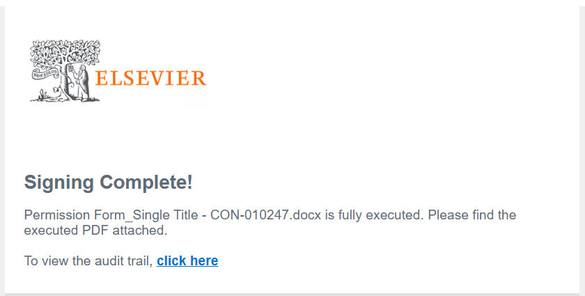

<!-- =====================================================
     HERO
========================================================= -->

<section class="insight-hero">

  

    Journal Development · Elsevier · Scopus
  

  <h1 class="insight-title">
    Elsevier Confirms Completion of the Permission Form for
    <em>Istinbath: Jurnal Hukum</em>
  </h1>

  

    The completion of the Single Title Permission Form marks
    another important administrative milestone in the journal's
    ongoing onboarding process with Elsevier.
  

  

    
      November 2026
    

    
      Istinbath: Jurnal Hukum
    

    
      UIN Jurai Siwo Lampung
    

  

</section>

<!-- =====================================================
     IMAGE
========================================================= -->

  

  

    Elsevier confirmation indicating that the Permission Form –
    Single Title (CON-010247) has been fully executed as part of
    the journal onboarding process.
  

<!-- =====================================================
     ARTICLE
========================================================= -->

  

    The administrative onboarding process of
    <em>Istinbath: Jurnal Hukum</em> with Elsevier has reached
    another important milestone. Elsevier has officially confirmed
    that the <strong>Permission Form – Single Title</strong> has
    been fully executed, marking the completion of a key
    administrative stage in the journal's ongoing onboarding process.
  

  

    The confirmation was communicated through a notice entitled
    <strong>“Signing Complete!”</strong>, indicating that the document
    <strong>Permission Form_Single Title – CON-010247</strong>
    had been fully executed. The final PDF of the signed document
    was also made available, together with an audit trail documenting
    the signing process.
  

  

    

      Onboarding Milestone
    

    

      The completion of the permission form represents a formal
      administrative step supporting the subsequent technical
      arrangements for content delivery, metadata processing,
      and further integration with Elsevier's indexing infrastructure.
    

  

  

    This development forms part of the broader
    <em>title onboarding</em> process undertaken after
    <em>Istinbath: Jurnal Hukum</em> was accepted for inclusion
    in Scopus. The completion of the permission form is particularly
    significant because it supports the administrative and technical
    arrangements required for content delivery, metadata processing,
    and further integration with Elsevier's indexing infrastructure.
  

  

    For <em>Istinbath: Jurnal Hukum</em>, this milestone represents
    more than the completion of a formal document. It reflects the
    journal's continuing commitment to strengthening editorial governance,
    improving publication management, and meeting the requirements of
    internationally recognised scholarly indexing systems.
  

  

    Published by the Faculty of Sharia, UIN Jurai Siwo Lampung,
    Indonesia, <em>Istinbath: Jurnal Hukum</em> focuses on Islamic law,
    legal studies, and contemporary developments in Sharia-related
    scholarship. The journal continues to expand its academic reach
    by encouraging high-quality research, strengthening international
    visibility, and promoting scholarly engagement across broader
    academic communities.
  

  

    The completion of the permission form is expected to support
    the next stage of the onboarding process, particularly the
    technical integration and content delivery arrangements required
    by Elsevier. This progress therefore marks another step in the
    journal's efforts to enhance its international presence and
    contribute more actively to global scholarly discourse in the
    field of Islamic law.
  

<!-- =====================================================
     DOCUMENT INFORMATION
========================================================= -->

<section class="document-section">

  

    Document Information
  

  <h2 class="document-section-title">
    Elsevier Permission Documentation
  </h2>

  

    

      
        Status
      

      <strong>
        Signing Complete
      </strong>

    

    

      
        Document
      

      <strong>
        Permission Form – Single Title
      </strong>

    

    

      
        Reference
      

      <strong>
        CON-010247
      </strong>

    

    

      
        Publisher
      

      <strong>
        Elsevier
      </strong>

    

  

</section>

<!-- =====================================================
     FOOTER
========================================================= -->

  <a
    href="/insights/"
    class="insight-footer-button"
  >
    ← Back to Insights
  </a>

  <a
    href="/main-publications/"
    class="insight-footer-button"
  >
    Main Publications
  </a>

  <a
    href="/research/"
    class="insight-footer-button"
  >
    Research →
  </a>

